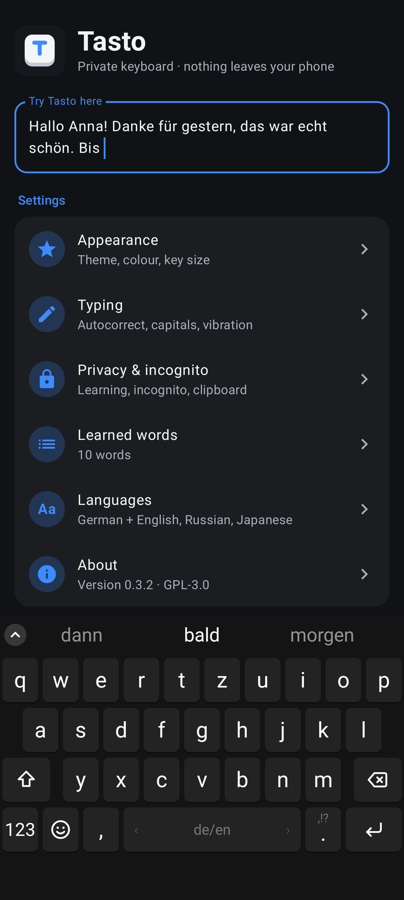
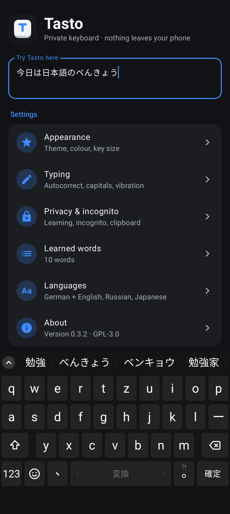
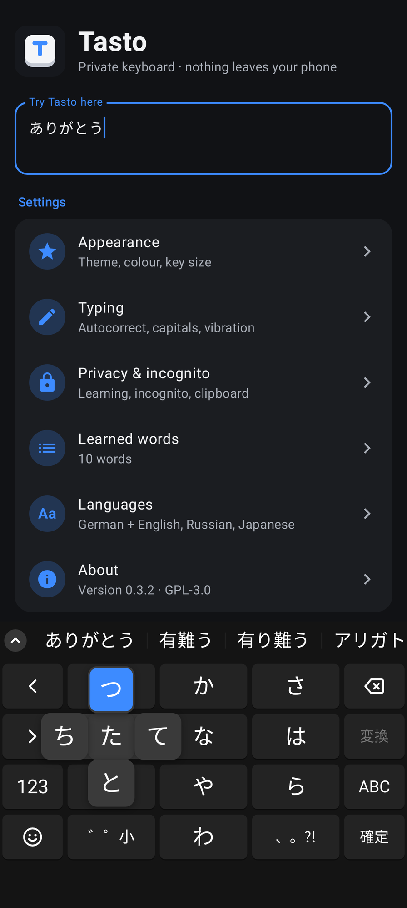
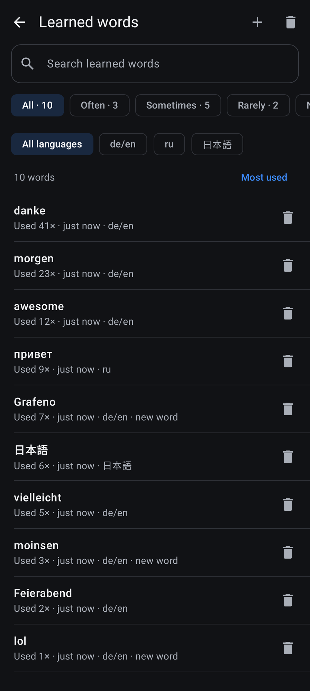
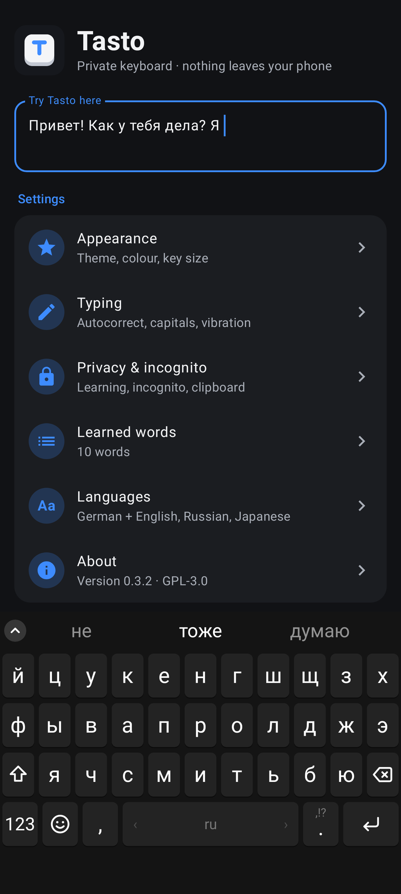
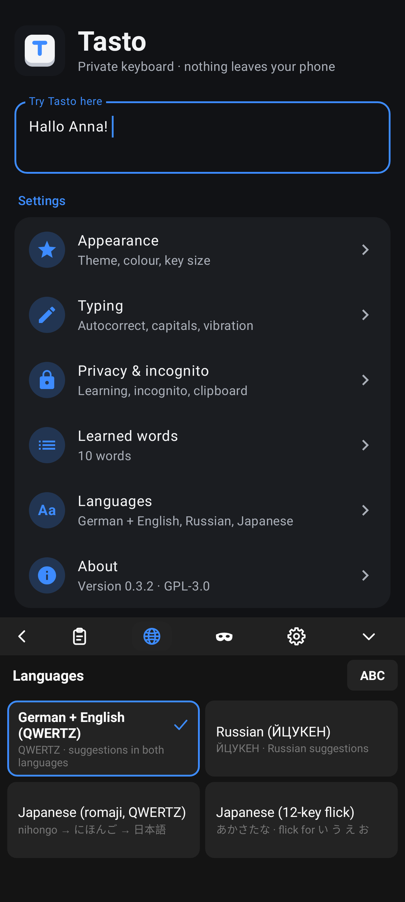
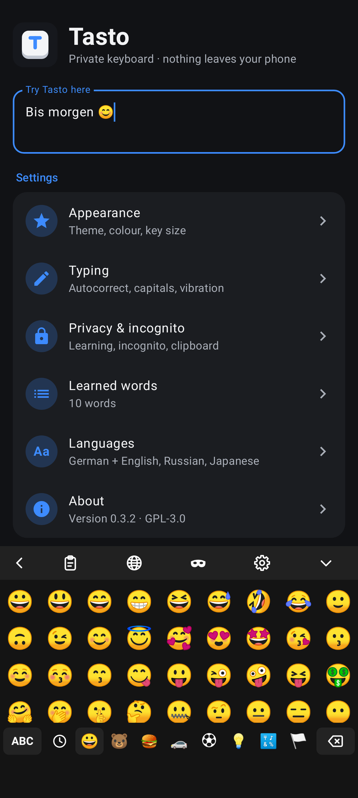
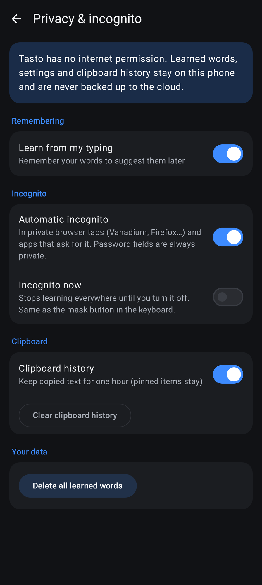

# Tasto

A private, Google-free keyboard for Android, built for GrapheneOS.

Tasto learns your words on your phone, goes incognito automatically in private browser tabs, and has **no internet permission**, so nothing you type can leave the device.

<p>




</p>
<p>




</p>

## Features

- **QWERTZ layout with German + English combined.** Suggestions in both languages at once, leaning towards the language you are writing in.
- **Russian (ЙЦУКЕН)** with its own suggestions, autocorrect and learned words.
- **Japanese**, two ways:
  - **Romaji on QWERTZ** (nihongo → にほんご), with ー next to L and 、。 at the bottom.
  - **12-key flick** like Gboard: tap あ, flick left/up/right/down for い う え お; ゛゜小 makes が, ぱ, っ; ◀ ▶ move the cursor; hold a key to see all five characters.
  - Kana → kanji conversion: candidates appear above the keys while you type (tap one to put it in), space converts (変換) and steps through them, Enter accepts (確定). Words with okurigana (食べました, 分かる), a word with its particle (今日は) and long readings piece by piece. Your choices are remembered, unless incognito.
- **Switching languages:**
  - Swipe the space bar left or right, like SwiftKey.
  - 🌐 in the toolbar (open it with the round button above the keys) lists your languages; tap one.
  - On the 12-key layout, ABC goes straight back to German + English; hold it for the list.
  - Each language is also in Android's own keyboard switcher (🌐 next to the navigation bar), once turned on via Languages → "Show languages in Android's 🌐 list".
  - All languages are on from the start; turn off the ones you don't need in Languages.
- **Suggestions and autocorrect.** Three suggestions above the keys, the best one in the middle. Autocorrect fixes typos, missing umlauts (uber → über), apostrophes (dont → don't) and noun capitals (haus → Haus). Press backspace right after a correction to undo it.
- **Remembrance.** Tasto learns the words and phrases you use and predicts your next word.
- **Learned-words manager.** See everything Tasto learned with how often you used it. Filter by Often / Sometimes / Rarely or new words only, search, sort, delete single words or all of them, or add words by hand.
- **Incognito.**
  - Turns on automatically in private browser tabs (Vanadium, Firefox…) and in apps that ask for no learning.
  - Password fields are always private.
  - A mask button in the toolbar turns incognito on everywhere.
  - While incognito nothing is learned, clipboard history is paused and emoji recents aren't saved.
- **Gestures.**
  - Long-press for accents, umlauts and digits (q = 1 … p = 0).
  - Swipe the space bar to switch languages; hold it, then slide, to move the cursor.
  - Hold backspace to delete whole words, one after another (a tap deletes one character).
  - Swipe left on backspace to delete a word.
  - Double-tap shift for caps lock.
  - Long-press a suggestion to forget a learned word.
- **Emoji panel** with recents, and a **clipboard panel**. Copied text is kept for one hour, pinned items stay, and text marked sensitive by password managers is never stored.
- **Looks.** Dark, light or system theme, six accent colours, three key sizes, optional number row.
- **Password fields** show the digits 1–0 above the letters automatically (can be turned off).
- **Easy way back** from the emoji, clipboard and language panels: the ‹ arrow, tapping the highlighted icon again, ABC, or Android's Back gesture.
- **Space after punctuation:** typing . , ! ? : ; after a word adds the space for you (not in numbers, addresses or abbreviations like z.B.). Can be turned off.
- **SwiftKey-style layout:** the same key sizes, symbol pages and suggestion row, with a round button that shows or hides the toolbar.
- **Special fields.** Number pad, phone pad, and email/URL layouts with "@" and "/" keys.
- **Accessible.** TalkBack reads every key, suggestion and toolbar button; long-press letters and flick characters are in TalkBack's actions menu. Key labels shrink to fit at the largest system font sizes, and keys are shorter in landscape.

## Privacy

- No `INTERNET` permission. The only permission is `VIBRATE`.
- No Google Play Services, no tracking or analytics libraries, and no downloadable fonts.
- Learned words, settings and clipboard history live in app-private storage. Android encrypts that storage at rest.
- Tasto's data is excluded from cloud backup and device-to-device transfer.

## Install

Download the APK from [Releases](../../releases) and open it on your phone. Then, in the Tasto app:

1. Tap **Open** and turn on Tasto in the keyboard list.
2. Tap **Switch** and choose Tasto.
3. Optional: to see Russian and Japanese in Android's own keyboard switcher (hold 🌐), go to Languages → **Show languages in Android's 🌐 list**, turn off "Use system languages" and tick them. Android doesn't let apps do this themselves.

Releases are signed with this certificate (SHA-256), so you can check the APK, for example with AppVerifier:

```
0c:c2:ca:fc:fc:5d:1c:2c:ad:96:17:99:94:ba:07:8e:f4:b7:6f:fd:1e:9e:7c:6e:4f:b9:85:e8:08:f1:62:69
```

## Build

Requires JDK 17+ and the Android SDK (platform 36).

```sh
./gradlew testDebugUnitTest   # 228 tests: engine, typing, touch, navigation, languages, Japanese, storage, screens
./gradlew assembleRelease
```

Release signing reads `keystore.properties`, which is not in the repository.

## Roadmap

1. German + English (QWERTZ) ✅
2. Russian (ЙЦУКЕН) ✅
3. Japanese: romaji on QWERTZ and 12-key flick, with kana → kanji conversion ✅

## Credits

- **Author:** RealKHFan
- **Co-author:** Claude (Anthropic), who helped design and write the code
- **German and Russian word lists:** [Leipzig Corpora Collection](https://wortschatz.uni-leipzig.de/en/download/) (CC BY 4.0), via [HeliBoard aosp-dictionaries](https://codeberg.org/Helium314/aosp-dictionaries)
- **English word list:** Android Open Source Project (Apache 2.0), via HeliBoard aosp-dictionaries
- **Conversational frequencies:** [OpenSubtitles 2018 lists by Hermit Dave](https://github.com/hermitdave/FrequencyWords) (CC BY-SA 4.0)
- **Japanese kana → kanji dictionary:** [SKK-JISYO.L](https://github.com/skk-dev/dict) by the SKK Development Team (GPL-2.0-or-later)
- **Japanese word frequencies:** OpenSubtitles 2018 lists by Hermit Dave (CC BY-SA 4.0)
- **Emoji data:** Unicode emoji-test.txt (Unicode License v3)

`tools/build_dicts.py`, `tools/build_ja.py`, `tools/build_ja_freq.py` and `tools/build_emoji.py` regenerate the assets from those sources.

## License

GNU General Public License v3.0. See [LICENSE](LICENSE).
